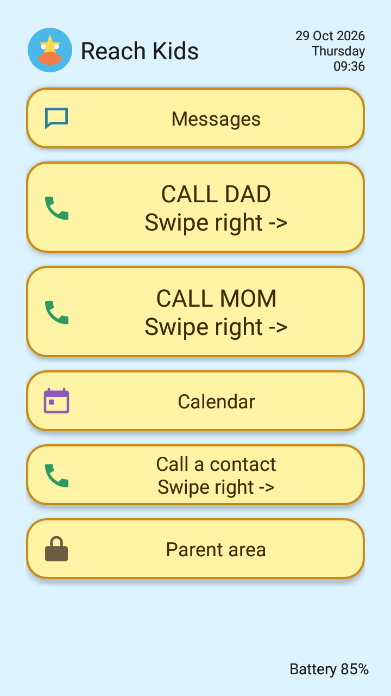

# Reach Kids

Reach Kids is a deliberately simple launcher-style app for Android phones. It is designed to also run on older Android 5 phones. So you can give your old Android phone to your child and she/he will be reachable via calls and SMSes but without any access to the other smart phone features and camera. The app runs on kiosk mode which locks the phone for the app use only. This is especially useful as not to disturb school activities. The parent can configure contacts and device settings while the child gets a large, restricted home screen for calling, SMS, and viewing calendar entries.



The app uses the phone's existing **Contacts** and **Calendar** providers. It does not maintain a second copy of contacts or calendar events.

> **Important:** Installing the APK by itself does not lock down an Android phone. Full kiosk mode requires device-owner provisioning on a factory-reset device. The simplified setup steps below use a Windows computer and Android Platform Tools; Android Studio is not required.

## Download APK

The current built APK is available in this repository:

- [Download Reach Kids test APK](downloads/ReachKids-0.1.0-phase1-debug.apk)

This is a **debug/test APK**, not a signed production release. Install it only on a device you control and test it thoroughly before child use. Its SHA-256 checksum is:

```text
C26B8E252C48072540CF4A9CAE1D262F507161E95AABEBFB921AD4E24EE3FC9D
```

## Simple kiosk setup for a dedicated child phone

Use this procedure if you want Reach Kids to enforce kiosk mode. It is intended for a dedicated child phone, not a phone already used normally by someone else.

### You need

- A Windows computer and USB data cable.
- The APK above.
- [Android SDK Platform Tools](https://developer.android.com/tools/releases/platform-tools), which provides `adb`. **Android Studio is not required.**
- A phone that can be factory-reset. The tested target is Samsung Galaxy A3 (2016), Android 7.

### Steps

1. **Factory-reset the phone.** During its first setup, do not add a Google account and do not complete normal user setup before enrollment.
2. If the setup screens allow it, enable **Developer options** and **USB debugging**.
3. On the Windows computer, unzip Platform Tools and copy `ReachKids-0.1.0-phase1-debug.apk` into that folder.
4. Connect the phone by USB. Open PowerShell in the Platform Tools folder, approve the USB-debugging prompt on the phone, then run:

   ```powershell
   .\adb.exe devices
   .\adb.exe install ReachKids-0.1.0-phase1-debug.apk
   .\adb.exe shell dpm set-device-owner com.reachkids.app/.ReachKidsDeviceAdminReceiver
   ```

5. Android should report that the device owner was set successfully. If the last command says the device has already been provisioned, factory-reset it again and repeat from step 1; do not attempt to bypass that Android restriction.
6. Open **Reach Kids**, create the parent PIN, configure contacts and SMS, then open **Parent area** and select **Enable kiosk mode**.
7. Test Home, Recents, phone calls, messages, reboot behavior, and Parent-area access before giving the phone to a child.

Without device-owner enrollment, the app itself still works, but it cannot securely keep the child inside Reach Kids. Manual Android screen pinning can be used for supervised testing only.

## What it is for

- A child-facing home screen with large, straightforward actions.
- Parent-protected setup and administration behind a numeric PIN.
- Contact-only calling and SMS composition: the child cannot type an arbitrary phone number in Reach Kids.
- Optional Android device-owner kiosk mode for the target handset.

## Features

### Child home

The front page is scrollable on smaller screens and currently includes:

1. **Messages** — SMS inbox, conversations, and contact-only new-message flow.
2. Two large parent-configured **quick-call** buttons, such as `CALL DAD` and `CALL MOM`.
3. **Calendar** — a read-only list of system-calendar events in the next 30 days.
4. **Call a contact** — a picker containing only phone-number rows from Android Contacts; there is no dial pad or manual number field.
5. **Parent area** — opens the parent PIN screen.

### Parent controls

After entering the parent PIN, a parent can:

- Add, edit, and remove phone contacts through the Android Contacts provider.
- Configure the two quick-call buttons by choosing an existing phone-contact number and providing a label.
- Change the parent PIN. The current PIN, a new PIN of at least four digits, and confirmation are required.
- Set up Reach Kids as the default SMS app and grant its requested SMS permissions.
- Enable or exit device-owner kiosk mode when the device has been provisioned correctly.
- Choose whether the camera is disabled while device policy is active.
- Enable **Ringer Muted**. This sets the call-ringer volume to zero and restores the prior ring volume when unticked; alarms and media volume are not changed.

### SMS behavior

- SMS only: incoming messages, thread list, per-number conversations, and outgoing messages are stored locally by Reach Kids.
- Incoming and outgoing messages have explicit direction labels.
- Unknown senders are readable, but replying is disabled until a parent adds that number to Android Contacts.
- A child starts a new message only by selecting a system contact.
- Outgoing messages show pending, sent, failed, and (when provided by the carrier) delivered states.
- A sent/failed toast is shown once per message, including multipart messages.
- Incoming-message deduplication prevents exact duplicate entries.

### Kiosk/calling behavior

When Reach Kids is the device owner and kiosk mode is enabled, it becomes the persistent Home app and enters lock task mode. The kiosk allowlist includes Reach Kids plus the Samsung/Android packages needed for the target phone's call handoff.

The active call screen is still provided by the device firmware. Test the exact handset, carrier, and firmware carefully before depending on kiosk calling in production.

## Deliberate limitations and safety notes

- **MMS, photos, attachments, and group messages are not supported.**
- This is not an emergency-dialer replacement and does not implement emergency-call workflows.
- Calendar is read-only in Reach Kids. Events are added and changed in the phone's normal calendar app/account.
- Reach Kids is not physically tamper-proof. Recovery mode, factory reset, SIM removal, and device firmware behavior are outside its control.
- A forgotten parent PIN has no recovery flow. The supported recovery path is factory reset and reprovisioning of the managed device.
- Kiosk behavior and Samsung system-call UI behavior must be validated on the actual target device before real-world use.

## User guide

### First-time setup

1. Install and open Reach Kids.
2. Create a numeric parent PIN with at least four digits, then confirm it.
3. On the child home, select **Parent area** and enter the PIN.
4. Add the phone contacts the child may call or message.
5. Configure quick-call buttons if wanted.
6. Select **Set up SMS (parent only)**, grant the permissions Android requests, and accept the default-SMS-app prompt.
7. Optionally configure **Ringer Muted** and the camera policy.
8. If the phone has been provisioned as device owner, enable kiosk mode from the parent area.

### Child use

- Tap **Messages** to read SMS or start a message by choosing a contact.
- Tap a quick-call button to call its parent-configured contact.
- Tap **Calendar** to view upcoming events. If prompted, allow calendar access.
- Tap **Call a contact** to select a saved phone contact and confirm the call.

### Parent use

1. From the child home, scroll if needed and select **Parent area**.
2. Enter the parent PIN.
3. Make contact, quick-call, SMS, ringer, camera, or kiosk changes.
4. Select **Lock parent area** when finished.

## Requirements

- Target/tested handset: **Samsung Galaxy A3 (2016)** running **Android 7.0 / API 24**.
- Minimum Android version supported by the app: **Android 5.0 / API 21**.
- Build configuration: `compileSdk 35`, `targetSdk 28`, Android Gradle Plugin 8.5.2, Java 8 source compatibility.
- For builds: Android Studio and JDK 17 are recommended, plus Android SDK Platform 35.

## Build from source

Clone the repository and run the Gradle wrapper from the repository root.

### Windows PowerShell

```powershell
.\gradlew.bat test assembleDebug --console=plain --no-daemon
```

### macOS/Linux

```bash
./gradlew test assembleDebug --console=plain --no-daemon
```

The debug APK is written to:

```text
app/build/outputs/apk/debug/app-debug.apk
```

## Install for ordinary development/testing

1. Enable USB debugging on the phone.
2. Connect the phone and confirm ADB can see it:

   ```bash
   adb devices
   ```

3. Install or update the debug build without clearing app data:

   ```bash
   adb install -r app/build/outputs/apk/debug/app-debug.apk
   ```

4. Open **Reach Kids** on the phone and complete the first-run parent PIN setup if needed.

This installation method is appropriate for feature testing only. It does **not** make the app the device owner or prevent normal access to Android settings and other apps.

## Device-owner kiosk provisioning

Device-owner enrollment normally requires a factory-reset phone before ordinary user/account setup is completed.

For the full, target-device-specific procedure, prerequisites, and acceptance checklist, read:

- [PROVISIONING.md](PROVISIONING.md)

The essential enrollment command is:

```bash
adb shell dpm set-device-owner com.reachkids.app/.ReachKidsDeviceAdminReceiver
```

Do not run it on a phone that has already been set up for normal daily use. If Android refuses the command because setup has progressed too far, factory-reset the test phone and follow the provisioning guide.

## Test checklist before deployment

On the exact target handset and carrier/SIM, verify:

- Parent PIN setup, lockout behavior, PIN change, and parent-area lock.
- Contact-only calling and quick-call buttons.
- SMS setup as the default SMS app; incoming, outgoing, multipart, failed/no-signal, and delivery-report behavior.
- One sent/failed popup per outgoing SMS and no duplicate incoming entries.
- Read-only calendar display and calendar permission behavior.
- Ringer mute and restoration behavior.
- Kiosk Home/Recents restrictions, reboot behavior, camera policy, exit/re-enable flow, and Samsung call-screen handoff.

## Project status

This repository is a development project, not a polished signed production release. Review the code, test the APK on the intended Android build, and create your own release signing, distribution, recovery, and support processes before broader deployment.

## License

See [LICENSE](LICENSE).